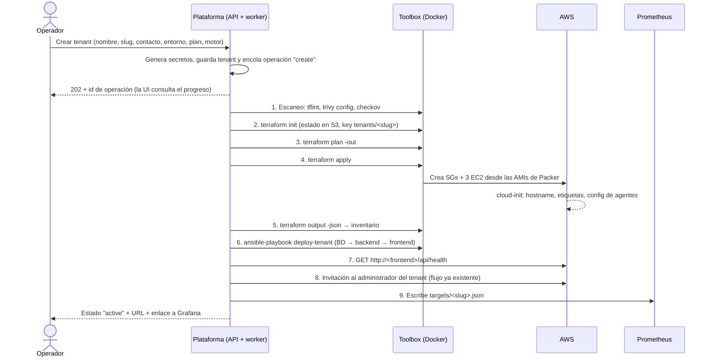

# Arquitectura de la plataforma multitenant

Diagrama visual: abre [`arquitectura.html`](arquitectura.html) en el navegador.

## 1. Piezas

| Pieza | Dónde corre | Qué hace |
| --- | --- | --- |
| **Plataforma** (`Admin-institucional`) | PC del operador (`npm`) | Catálogo de planes, alta de tenants, cola de operaciones en segundo plano, ejecución del motor IaC, historial y alertas. |
| **Toolbox IaC** (`infra/toolbox`) | Contenedor Docker local | Terraform, Packer, Ansible, tflint, trivy y checkov con versiones fijas. La plataforma lanza cada comando dentro del contenedor. Ansible no corre nativo en Windows y así todos los integrantes usan las mismas versiones. |
| **Monitoreo** (`monitoring/`) | PC del operador (`docker compose`) | Prometheus recolecta métricas de las EC2; Grafana muestra paneles y dispara alertas. |
| **Bootstrap AWS** (`infra/terraform/bootstrap`) | AWS, una sola vez | Bucket S3 del estado de Terraform y key pair SSH. |
| **Tenant** (`infra/terraform/tenant`) | AWS, uno por institución | Tres EC2: frontend, backend y base de datos, con sus security groups. |
| **AMIs** (`infra/packer`) | AWS, una vez por versión | Imágenes preconfiguradas por rol. Todos los tenants las reutilizan. |

## 2. Red de un tenant

Todos los tenants usan la **VPC por defecto** de la cuenta y sus subredes públicas.
Terraform no crea redes: las lee con `data "aws_vpc"` y `data "aws_subnets"`. Las 3 EC2
de cada tenant tienen IP pública, para que Ansible entre por SSH y Prometheus lea sus
métricas sin saltos intermedios.

El aislamiento lo dan los **Security Groups**, no las subredes. Dentro de una VPC, todas
las subredes se comunican entre sí por defecto. Por eso, separar subredes no aislaría a
un tenant de otro.

| Instancia | Entrada permitida |
| --- | --- |
| **Frontend** (IP elástica, la URL no cambia al suspender) | `:80` desde internet. Nginx sirve el `dist/` de React y reenvía `/api` y `/api/socket.io` al backend. |
| **Backend** | `:3000` solo desde el SG del frontend **del mismo tenant**. |
| **Base de datos** | `:5432` solo desde el SG del backend **del mismo tenant**. |
| Las tres | `:22` (Ansible) y los puertos de métricas (`9100`, `9256`, `19999`, `8889`) solo desde la IP pública del operador. |

**Aislamiento entre tenants**
- Cada tenant tiene su propia instancia de PostgreSQL con usuario y contraseña propios.
- Su `JWT_SECRET` y su `PLATFORM_BOOTSTRAP_KEY` también son propios.
- Sus SG solo aceptan tráfico de los SG del mismo tenant. El backend del tenant B no puede abrir conexión con la base del tenant A. Prueba: `nc -zv <ip-bd-A> 5432` desde el backend de B termina en timeout.

**Concesiones por el Free Tier.** Una red privada con NAT Gateway cuesta dinero. Por eso
los scanners avisarán de "instancia con IP pública" y de reglas similares. Sus resultados
se muestran en el log de cada operación, pero esas advertencias no bloquean el despliegue.

## 3. Flujo de creación de un tenant

Cada paso queda en el log de la operación, con los secretos redactados. Si un paso
falla, la operación queda en `failed` con un mensaje comprensible. Al reintentar, se
vuelve a ejecutar la misma secuencia. `terraform apply` y los playbooks son
idempotentes, así que reintentar no duplica recursos.

## 4. Rol de cada herramienta

| Herramienta | Función en la arquitectura |
| --- | --- |
| **Terraform** | Crea los recursos AWS: el bootstrap (S3 de estado, key pair) y el stack de cada tenant (SGs, 3 EC2, IP elástica en la VPC por defecto). También suspende y reanuda con `aws_ec2_instance_state`. |
| **Packer** | Construye las 3 AMIs (`frontend`, `backend`, `database`) sobre Ubuntu 24.04. Hornea paquetes y agentes de monitoreo para que el aprovisionamiento de cada tenant sea rápido y repetible. |
| **cloud-init** | Configura el primer arranque de cada EC2: hostname, archivo de identidad (`tenant`, `role`, `environment`), config de los agentes y habilitar servicios. No recibe secretos. |
| **Ansible** | Configura después del arranque y despliega. En la base de datos crea la BD y el usuario y ajusta `pg_hba`. En el backend copia el artefacto de NestJS, escribe `.env` con los secretos y crea el servicio systemd. En el frontend copia el `dist/` y configura Nginx. Packer también usa sus roles para construir las AMIs. |
| **tflint / trivy / checkov** | Analizan el código Terraform antes de cada `apply`. tflint revisa errores y buenas prácticas; trivy y checkov revisan seguridad (IMDSv2, cifrado, reglas de entrada…). Sus resultados aparecen en el log de la operación. |
| **node_exporter** | Expone métricas del sistema operativo: CPU, RAM, disco y red. |
| **process-exporter** | Expone métricas por proceso: nginx, node y postgres. |
| **netdata** | Panel en tiempo real por máquina, y también un endpoint en formato Prometheus. |
| **OpenTelemetry Collector** | Recibe por OTLP las métricas HTTP del backend (latencia y errores) y, en la BD, consulta PostgreSQL (receptor `postgresql`). Las expone en formato Prometheus. |
| **Prometheus** | Lee periódicamente (modelo *pull*) los endpoints anteriores y guarda series temporales con etiquetas `tenant`, `environment` y `role`. |
| **Grafana** | Consulta Prometheus, muestra paneles por tenant y entorno y evalúa reglas de alerta. Las alertas llegan a la plataforma por webhook. |

## 5. Estado de Terraform

- **Backend S3**: un bucket creado por el bootstrap con versionado, cifrado SSE-S3, bloqueo de acceso público y bloqueo nativo de S3 (`use_lockfile = true`, sin DynamoDB).
- **Una key por tenant** (`tenants/<slug>/terraform.tfstate`): una operación sobre un tenant no puede tocar el estado de otro.
- **El bootstrap** guarda su propio estado en local (`infra/terraform/bootstrap/terraform.tfstate`, ignorado por git), porque es quien crea el bucket.
- **Secretos fuera del estado**: las contraseñas de BD, el `JWT_SECRET` y la bootstrap key no pasan por Terraform. La plataforma los genera, los guarda cifrados (AES-256-GCM) en su base y se los entrega solo a Ansible en tiempo de ejecución.
- **Credenciales AWS**: se toman del perfil local (`~/.aws`), montado en el contenedor solo lectura. Nunca se guardan en el repositorio.

## 6. Política de suspensión y retención

- **Suspender**: `desired_state = "stopped"` detiene las 3 EC2. Se deja de pagar cómputo. Los volúmenes EBS (con los datos de PostgreSQL), la IP elástica y los SG se conservan. Las IP públicas no elásticas del backend y la BD cambian al reanudar; Terraform las vuelve a leer y la plataforma actualiza los targets. Los targets de Prometheus se marcan `suspended` para que no salten alertas de caída.
- **Reanudar**: `desired_state = "running"` vuelve a arrancar las instancias. Ansible no es necesario porque la configuración vive en disco. La plataforma espera a que `/api/health` responda.
- **Retención**: mientras el tenant está suspendido, sus datos se conservan sin límite.
- **Eliminar**: primero se muestra el resultado de `terraform plan -destroy` y el operador confirma escribiendo el slug. La eliminación borra las EC2 y sus volúmenes, así que los datos se pierden. Los respaldos (RF-19) quedan fuera de esta versión.

## 7. Puntos de extensión (requisitos opcionales)

| Requisito | Dónde se enchufa |
| --- | --- |
| Pulumi / CloudFormation (RF-08) | `Admin-institucional/server/src/provisioning/engines/`: implementar la misma interfaz y devolver el mismo contrato de outputs. Ansible, cloud-init, Packer y monitoreo se reutilizan tal cual. |
| Cambio de plan (RF-06) | Los tamaños son variables de Terraform. Bastaría con un `plan` con el nuevo `instance_type` y mostrar el diff. |
| Actualizar app/infra (RF-15) | Nueva operación `update` que reutiliza los pasos `apply` + `ansible`. |
| Respaldos (RF-19) | Snapshots EBS o `pg_dump` hacia S3 desde un rol de Ansible. |
| Auditoría (RF-20) | `platform_operations` deja reservada la columna del actor. |
| Límites del plan (RF-05) | Los límites viven en `platform_plans`. Se aplicarían como variables de entorno de la app. |
